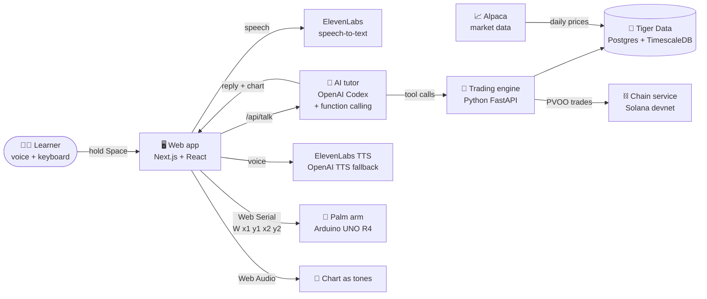
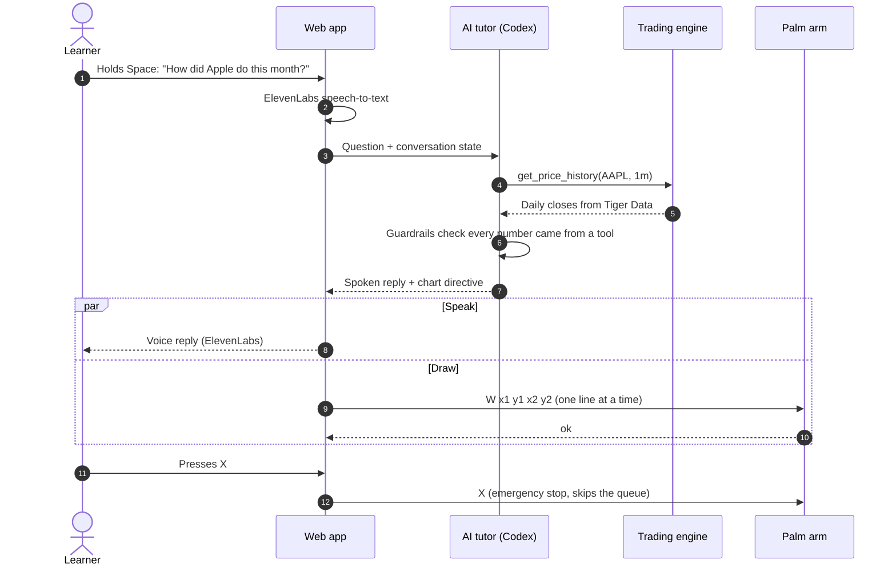
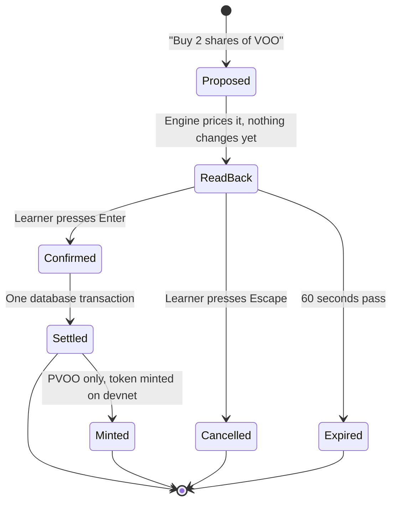

<!-- Header wave -->
<p align="center">
  
</p>

<p align="center">
  <a href="https://devpost.com/software/sonar-97f4c1">
    
  </a>
</p>

<p align="center">
  <a href="https://technica-2026.devpost.com/"></a>
  <a href="https://devpost.com/software/sonar-97f4c1"></a>
  
</p>

<p align="center">
  
</p>

<p align="center">
  
  
  
  
</p>

<p align="center">
  <a href="#-what-it-does">What it does</a> •
  <a href="#-gallery">Gallery</a> •
  <a href="#-how-it-works">How it works</a> •
  <a href="#tech-stack">Tech stack</a> •
  <a href="#controls">Controls</a> •
  <a href="#-the-palm-arm">Palm arm</a> •
  <a href="#-testing">Testing</a> •
  <a href="#-team">Team</a>
</p>

<p align="center">
  
</p>

---

## 🌊 Inspiration

We all wear glasses, which made us wonder how people with no vision handle everyday tasks the rest of us take for granted. The ocean theme pointed us to the deep sea, where sunlight never reaches but whales and dolphins still find their way by **sound and touch**. Their world isn't smaller without light; they just navigate it differently.

Finance stood out as one of the biggest barriers for blind people, because trading is taught almost entirely through charts. So we built a way to dive into the markets the same way life thrives in the deep: **by sound and by touch**.

> [!NOTE]
> Like sonar in the deep ocean, Sonar is a way to navigate without sight.

## 🐬 What it does

**Sonar is a voice-first investing tutor for blind and low-vision learners.**

| | |
| --- | --- |
| 🎙️ **Ask out loud** | Hold <kbd>Space</kbd> and ask *"How did Apple do this month?"* or *"What if I'd put $1,000 into VOO a year ago?"*. Sonar answers in a natural voice using **real market data, never numbers from memory**. |
| ✋ **Feel the chart** | A small robotic arm draws the price line **on your palm** and taps at key moments like a peak or a finished trade. |
| 🎵 **Hear the chart** | Or press <kbd>S</kbd> and the chart plays as rising and falling tones. |
| 💵 **Practice trading** | Start with **$10,000 in practice money** for stocks, ETFs and options, with a spoken read-back and a confirmation step before anything happens. |
| 📚 **Learn step by step** | Six short lessons with quizzes, covering reading a graph, stocks vs. ETFs and fees, a first trade, tokenized funds, backtesting, and options basics. |
| ⛓️ **See tokenization** | **PVOO** is a practice token on Solana devnet that mirrors one share of VOO. Buying it mints a real token that settles in about two seconds, and anyone can check its backing on the public blockchain. |

> [!IMPORTANT]
> Sonar is a learning tool. **No real money moves**, and the tutor never gives personal financial advice.

## 📸 Gallery

<table>
  <tr>
    <td width="50%" align="center">
      
      <br /><sub><b>Home:</b> numbered menus that are read aloud, and push-to-talk</sub>
    </td>
    <td width="50%" align="center">
      
      <br /><sub><b>Ask out loud:</b> the answer is spoken while the arm draws the chart</sub>
    </td>
  </tr>
  <tr>
    <td width="50%" align="center">
      
      <br /><sub><b>Palm scene:</b> the on-screen arm mirrors the real one</sub>
    </td>
    <td width="50%" align="center">
      
      <br /><sub><b>The palm arm:</b> 3D-printed, Arduino-driven, three joints</sub>
    </td>
  </tr>
</table>

## 🧭 How it works



<details>
<summary><b>🔁 One question, start to finish</b> (click to expand)</summary>



</details>

<details>
<summary><b>💸 How a practice trade stays safe</b> (click to expand)</summary>



</details>

<a id="tech-stack"></a>

## 🛠️ Tech stack

<p align="center">
  <a href="https://skillicons.dev">
    
  </a>
</p>

<p align="center">
  
  
  
  
  
  
</p>

| Layer | Technology | What it does |
| --- | --- | --- |
| 🖥️ **Frontend** | Next.js 15, React 19, TypeScript, CSS | A single screen built for keyboard and screen-reader users: push-to-talk, numbered menus read aloud, live-region announcements, and focus that never leaves you lost |
| 🎵 **Sound** | Web Audio API | Sonification turns chart height into pitch, and short earcons signal what's happening |
| 🎙️ **Voice** | ElevenLabs (Scribe STT + TTS), OpenAI `gpt-4o-mini-tts` | Speech in and out. OpenAI is the backup voice, and the browser voice is the last resort |
| 🧠 **AI tutor** | OpenAI Codex (`gpt-5.3-codex`), Responses API, function calling | Picks from tools for quotes, charts, backtests, trades, lessons and token backing. Guardrails block any number that didn't come from a tool, any personal advice, and any claim of a trade the learner never confirmed |
| 🐍 **Trading engine** | Python, FastAPI, Uvicorn, psycopg | A practice brokerage with two-step trades, backtests, coaching tips, and Black-Scholes options pricing |
| 🐯 **Database** | Tiger Data (Postgres + TimescaleDB) | Hypertables for prices, plus continuous aggregates for weekly and monthly candles. Every trade is one transaction |
| 📈 **Market data** | Alpaca | Daily prices, with CSV backups if the database is down |
| ⛓️ **Blockchain** | Solana devnet, `@solana/web3.js`, `@solana/spl-token` | PVOO token: buys mint, sells burn, and a backing check compares on-chain supply to the ledger |
| 🦾 **Hardware** | Arduino UNO R4, servos, 3D-printed arm, C++ | Inverse kinematics and smooth, speed-limited motion inside a 50 × 30 mm box on the palm |
| 🔌 **Arm link** | Web Serial API | The browser talks to the arm over USB, one command at a time |
| 🧪 **Testing** | Vitest, Playwright, axe-core | Unit tests, keyboard-only end-to-end tests, and automatic accessibility checks |
| 🧰 **Tooling** | Task Master, Claude Code, Git, GitHub | Planning from the PRD, and AI help with the frontend, tests, firmware and CAD |

<details>
<summary><b>🧰 The tutor's tools</b> (click to expand)</summary>

| Trading | Tutoring |
| --- | --- |
| `list_markets`, `get_quote`, `get_price_history`, `show_chart` | `start_lesson`, `next_step`, `answer_quiz` |
| `propose_trade`, `confirm_trade`, `cancel_trade` | `confirm_lesson_trade` |
| `get_option_quote`, `propose_option_trade` | `suggest_options`, `explain_fees` |
| `get_portfolio`, `review_trades`, `run_backtest` | |
| `check_token_backing` | |

</details>

### 🛟 Built to keep working

| If this goes down… | Sonar does this instead |
| --- | --- |
| The database | Quotes, charts and backtests come from CSV backups |
| Solana devnet | The trade still fills and is clearly marked **simulated** |
| ElevenLabs | OpenAI speaks the reply, then the browser's own voice |
| The microphone | Press <kbd>T</kbd> to type the question |
| The palm arm | Charts play as sound, and the on-screen arm still draws |

<a id="controls"></a>

## ⌨️ Controls

| Key | Action |
| --- | --- |
| <kbd>Space</kbd> (hold) | Talk. Hold for at least 250 ms, then release to send |
| <kbd>1</kbd>–<kbd>9</kbd> | Choose a menu option |
| <kbd>M</kbd> | Open the menu |
| <kbd>R</kbd> | Repeat the last reply and redraw its chart, with no new API call |
| <kbd>S</kbd> | Play the chart as sound |
| <kbd>T</kbd> | Type a question instead of speaking |
| <kbd>N</kbd> / <kbd>→</kbd>, <kbd>P</kbd> / <kbd>←</kbd> | Next or previous lesson step |
| <kbd>Enter</kbd> | Confirm a trade |
| <kbd>Esc</kbd> | Cancel recording, a pending question, or a trade |
| <kbd>X</kbd> | **Emergency stop for the palm arm** |

## 🦾 The palm arm

<p align="center">
  
</p>

The arm is a 3D-printed, three-joint arm on an **Arduino UNO R4**. The browser connects to it over **Web Serial** at 115200 baud and sends **one command at a time**, waiting for each `ok` before the next.

| Command | Meaning |
| --- | --- |
| `W x1 y1 x2 y2` | Draw one straight line. Coordinates are 0–1000 across a 50 × 30 mm box on the palm |
| `P` | Ping |
| `T` | Trace the drawing box so the learner can position their hand |
| `S n` | Set the drawing speed in mm/s |
| `H` | Home |
| `X` | **Emergency stop**, which skips the queue |
| `R` | Resume after a stop |

Every chart is resampled to about 10 points, scaled into the box with 8% margins, and sent as one `W` line per segment. Taps, such as a peak or a finished trade, become zero-length lines.

**To connect:**
1. Plug the arm into USB and close the Arduino Serial Monitor (only one program can use the port).
2. Click **Connect arm** in the top-right panel and choose the Arduino's port.
3. Wait for **"Palm arm: connected"** (the board restarts, which takes about 2 seconds).
4. Click **Trace box** to find the drawing area, then ask a chart question.
5. Press <kbd>X</kbd> or **Stop arm** at any time, then **Resume arm** to continue.

The driver is in [`backend/bridge/serial/palmArm.ts`](backend/bridge/serial/palmArm.ts), and chart drawing is in [`backend/bridge/serial/palmChart.ts`](backend/bridge/serial/palmChart.ts).

## 🐍 Trading engine API

<details>
<summary><b>Endpoints</b> (click to expand)</summary>

| Endpoint | What it does |
| --- | --- |
| `GET /health` | Market hours, and whether prices come from the database or the CSV backup |
| `GET /markets` | Tradable assets: VOO, SPY, QQQ, AAPL, MSFT, NVDA, PVOO, and options on the six equities |
| `GET /quote?symbol=VOO` | Last close, plus a spoken note when the market is closed |
| `GET /history?symbol=AAPL&range=1m` | Daily closes (`1w`, `1m`, `3m`, `6m`, `1y`, `2y`, or a date) |
| `POST /propose` `{side, symbol, qty}` | Step 1: price, total, risk note, and a read-back. Changes nothing |
| `POST /confirm` `{id}` | Step 2: executes a live proposal (60 s), otherwise returns `409` |
| `POST /cancel` `{id}` | Drops a proposal |
| `GET /portfolio` | Cash, holdings, gain or loss, and a coaching tip every 3 trades |
| `POST /backtest` `{symbol, amount, start}` | End value, return, and maximum drawdown with dates |
| `GET /review` | Trade history, newest first |
| `GET /options/quote?underlying=AAPL&type=call&strike=350&expiry=2026-11-20` | Contract cost, break-even, max loss and gain, and profit at expiry (or pass `symbol=AAPL-C-350-20261120`) |

</details>

<details>
<summary><b>Rules the engine enforces</b> (click to expand)</summary>

- Nothing trades without `/confirm`, and a proposal executes at most once.
- Cash never goes negative. The debit is conditional, and a database constraint backs it up.
- Stocks and ETFs trade in whole shares. PVOO allows fractions (up to 6 decimals).
- PVOO is priced 1:1 with VOO. If the chain service doesn't answer within 8 seconds, the trade still fills and is marked `simulated`.
- Prices fill in whole cents, and weekend quotes say they are Friday's close.
- Options are whole contracts of 100 shares, priced with Black-Scholes from each stock's own volatility over the past year. Learners can buy contracts or sell ones they own, never write them, so the most they can lose is what they paid.
- If the database is unreachable at startup, the engine still starts. Quotes, charts and backtests come from the CSV backup, and account endpoints return `503 database_unavailable`.
- By default it trades on the "Demo learner" account. Set `ENGINE_ACCOUNT_ID` to use another.

</details>

## 🧪 Testing

```bash
npm test                 # all unit tests (Vitest)
npm run test:e2e         # keyboard-only browser tests (Playwright, production build)
npm run typecheck        # type-check the whole repo
```

- **Hardware without hardware:** a mock arm answers like the real firmware, and a fake `navigator.serial` checks the real protocol end to end (115200 baud, ping first, one `W` line per segment, never more than one command waiting).
- **Accessibility:** axe-core runs in the browser tests, and [`frontend/tests/a11y-manual-checklist.md`](frontend/tests/a11y-manual-checklist.md) covers the manual NVDA screen-reader pass.
- **Engine:** `cd backend/services/engine && .venv/Scripts/python -m pytest` runs the API tests on a throwaway account that cleans up after itself.

<details>
<summary><b>📜 All scripts</b> (click to expand)</summary>

| Command | What it does |
| --- | --- |
| `npm run dev` | Start the web app in development mode |
| `npm run build` | Production build of the web app |
| `npm test` | Run all unit tests (Vitest) |
| `npm run test:frontend` | Frontend unit tests only |
| `npm run test:backend` | Backend unit tests only |
| `npm run test:e2e` | Keyboard-only browser tests (Playwright) |
| `npm run typecheck` | Type-check the whole repo |
| `npm run db:migrate` | Create or update the database schema |
| `npm run db:refresh` | Materialize all weekly and monthly candles |
| `npm run test:db` | Database integration tests (uses `TEST_DATABASE_URL`, else `DATABASE_URL`) |
| `npm run chain:setup` / `npm run chain` | One-time PVOO devnet setup / run the chain service |
| `npm run test:devnet` | PVOO tests on Solana devnet (needs funded devnet SOL) |
| `npm run test:live` | Tutor tests against the real Codex model and a running engine (uses API quota) |
| `npm run test:firmware` | Arm IK, motion and protocol tests compiled for your computer (needs a C++ compiler) |

</details>

## 🗂️ Repository layout

<details>
<summary><b>Folder tree</b> (click to expand)</summary>

```
frontend/                      Frontend
  web/                         Next.js app
    app/page.tsx, components/  The single-screen UI, answer card, arm controls
    app/api/                   Route handlers that call backend/
    lib/voice/                 Push-to-talk, earcons, streaming TTS player
    lib/palm/                  Palm scene drawing, arm motion, sonification
    lib/a11y/, lib/state/      Keymap, live region, app state machine
  tests/unit/                  State machine, menus, palm, trade and voice tests
  tests/e2e/                   Keyboard-only Playwright tests, including the arm

backend/                       Backend
  services/engine/             Python: practice brokerage, ingest, chart series, CSV fallback
  services/tutor/              Codex loop, tools, guardrails, speech style
  services/lessons/            Six lessons as JSON, step player, quiz, progress
  services/chain/              PVOO mint, burn and supply on Solana devnet
  services/voice/              ElevenLabs STT and TTS, OpenAI TTS fallback, cache
  services/data/               Tiger Data schema, migrations, DB connection
  services/config/             Environment validation
  bridge/serial/               Palm arm driver (Web Serial + mock) and chart-to-lines drawing
  firmware/palm_arm/           Earlier ESP32 prototype firmware
  tests/                       Unit, database, devnet and live tests

data/                          CSV price backups (the TTS cache is gitignored)
```

Contract files (changes need both sides to review):
- `backend/services/tutor/tools/types.ts`: the `Directive` and `TurnState` shapes the UI reacts to
- `backend/services/chart/ops.ts`: the chart format used by the palm scene, sonification and the arm

</details>

<details>
<summary><b>📋 Task tracking</b> (click to expand)</summary>

Tasks are generated from the PRD ([`.taskmaster/docs/prd.txt`](.taskmaster/docs/prd.txt)) with [Task Master](https://github.com/eyaltoledano/claude-task-master) and split into three tags:

```bash
task-master use-tag frontend   # or backend, or shared
task-master next
```

| Tag | Tasks |
| --- | --- |
| `frontend` | 4 app shell, 9 voice, 13 space bar and tray, 14 menus and settings, 15 answer card and quiz, 16 palm scene, 17 sonification, 18 trade confirm UI, 21 accessibility |
| `backend` | 2 schema, 3 lessons, 5 price ingest, 6 chart series, 7 trading engine, 8 PVOO chain, 10 tutor, 11 guardrails, 12 lesson engine, 19 firmware, 20 arm bridge, 24 options (stretch) |
| `shared` | 1 infrastructure, 22 integration testing, 23 demo and Devpost |

</details>

## 🏆 Accomplishments

> [!TIP]
> 🏆 **Sonar won [MLH] Best Use of Solana at Technica 2026** for PVOO, our practice token that teaches tokenization by minting and burning real SPL tokens on Solana devnet, with an on-chain backing check anyone can verify.

- [x] Built it like a research project: a rough draft of ideas, a real problem, and every decision centered on it
- [x] Prototyped a mock webpage with Claude first, to test how blind and low-vision users would move through it
- [x] A tutor that can't make up prices or returns, and guides every practice trade safely
- [x] A 3D-printed arm that draws real stock charts on your hand
- [x] Our first hackathon project, and we finished it

## 🔭 What's next

- [ ] Trading with real money, starting with Solana and expanding to stocks, options and other assets, keeping the spoken read-back and two-step confirmation
- [ ] A smarter tutor that coaches each user on their own portfolio, builds lessons around their goals, and explains market news as it happens
- [ ] Steadier, smoother arm movement
- [ ] A CI pipeline that runs the unit and end-to-end tests on every pull request

## 👥 Team

<table>
  <tr>
    <td align="center" width="33%">
      <a href="https://devpost.com/srivastkris06"><b>Krishn Srivastava</b></a><br />
      <sub>Frontend + backend</sub><br />
      <sub>Accessible Next.js interface, Web Serial palm arm link, Vitest and Playwright tests, and paper trades with Solana, Tiger Data and Codex</sub>
    </td>
    <td align="center" width="33%">
      <a href="https://devpost.com/send2satvikd"><b>Satvik Dronavalli</b></a><br />
      <sub>Backend</sub><br />
      <sub>Solana, Tiger Data and Codex for efficient paper trading</sub>
    </td>
    <td align="center" width="33%">
      <a href="https://devpost.com/abapuram318"><b>Atharv Bapuram</b></a><br />
      <sub>Hardware</sub><br />
      <sub>CAD, building the arm, and the Arduino code</sub>
    </td>
  </tr>
</table>

<p align="center">
  
  
</p>

<!-- Footer wave -->
<p align="center">
  
</p>
